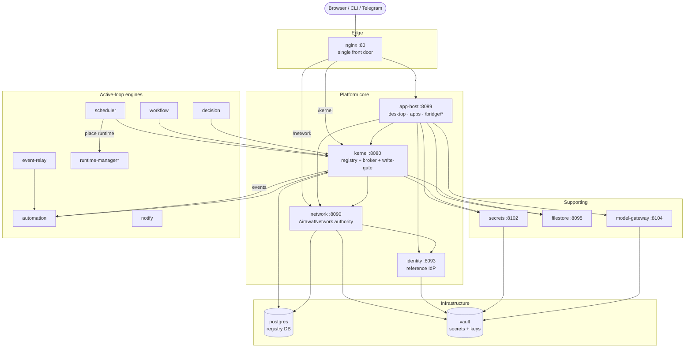

# Services & topology

AirawatOS runs as a set of small, single-purpose services behind one reverse proxy. This page explains what
each service does and how they wire together. For a conceptual view of the *two governed APIs* (kernel +
network) and the layer model, see [services-and-apis.md](../services-and-apis.md); for the component
confinement model (the trust rings), see [architecture/airawatos-runtime-rings.html](airawatos-runtime-rings.html).

## Topology



\* `runtime-manager` (and `mospi-gateway`, `keycloak`) are omitted from the local install — see
[install-local.md](../install-local.md).

## The spine, in one paragraph

The **browser** only ever talks to **nginx**, which routes `/` to **app-host** (the OS shell + apps + the
`/bridge/*` seam), `/network` to **network** (the federation authority), and `/kernel` to the **kernel**
(registry + broker). The **kernel** is the trusted core: it owns the governed **registry** (in **postgres**)
and the **broker** — the only I/O door a confined component gets — and enforces the zero-trust write gate.
**network** is the standards body / marketplace. **identity** issues tokens (signing key in **vault**).
Everything secret — per-tenant component keys, steward keys, the identity signing key — lives in **vault**,
reached through **secrets** for per-tenant component config. Blobs (app bundles, component source, uploads)
live in **filestore**. The **engines** (scheduler, workflow, decision, automation, event-relay, notify) drive
the active platform loop against the kernel.

## Per-service reference

| Service | Image (pinned) | Port | Role | Depends on | Persists |
|---|---|---|---|---|---|
| **postgres** | postgres:16-alpine | 5432 | Relational store behind the kernel's registry (DB `kernel`). | — | `kernel_pg` |
| **vault** | hashicorp/vault:1.15 | 8200 | All secrets + signing keys. Auto-init + auto-unseal on boot. | — | `vault_data` |
| **kernel** | airawatos-kernel:0.2.8-devgrant | 8080 | Governed **registry** + **broker** (only component I/O door) + zero-trust write gate. | postgres, network | — (DB) |
| **network** | airawatos-network:0.3.5-zoho-keyprefix | 8090 | **AirawatNetwork**: marketplace/store, schema+interface governance, directory, publish-requests, service offerings, join/email. | postgres, vault, identity | `netfiles` |
| **identity** | airawatos-reference:0.2.83-auth | 8093 | Reference **IdP**: realms, `/login`, JWKS, Ed25519 tokens (key in vault). Pinned tag (ADR-0096). | network, vault | `identity_data` |
| **secrets** | airawatos-reference (shared) | 8102 | Per-tenant component-secret manager → Vault at `secret/<tenant>/<component>/<name>`. | vault, identity | — (Vault) |
| **filestore** | airawatos-reference (shared) | 8095 | Content-addressed blob store: app bundles, component source tars, uploads. | — | `filestore_data` |
| **model-gateway** | airawatos-reference:0.2.95-gwreason | 8104 | Routes `/embed` + `/complete` to the configured LLM provider (key from Vault). | kernel, vault | — |
| **scheduler** | airawatos-reference:0.2.100-sched-devenv | 8103 | Scheduled / on-demand component runs; materializes source from filestore. | kernel, network | — |
| **workflow** | airawatos-reference (shared) | 8097 | Declaration-driven lifecycle runtime (`request`/`decide`/`update`). | kernel, network | — |
| **decision** | airawatos-reference (shared) | 8096 | Decision loop (facts + rules → signed decisions → outcomes). | kernel, network, workflow | — |
| **automation** | airawatos-reference (shared) | 8098 | Rule/alert engine; the kernel's event sink. | kernel | — |
| **event-relay** | airawatos-reference (shared) | — | Relays registry-write events to subscribers. | kernel, automation | — |
| **notify** | airawatos-reference (shared) | — | Inbox / notification arrival. | kernel | — |
| **app-host** | airawatos-reference:0.2.115-settings-fixes | 8099 | The **OS**: desktop shell, tenant apps, `/bridge/*` (secrets, settings, email…), `/t/<tenant>` public sites, login/landing. | kernel, identity (+ network, secrets, filestore, gateway) | `app_bundles` |
| **nginx** | nginx:alpine | 80 | Single front door; routes `/`, `/network`, `/kernel`. | app-host, network, kernel | — |
| **runtime-manager**\* | airawatos-reference:0.2.97-rtmgr-devtest | 8105 | Places heavy sandboxed runtime-profile containers; holds the Docker socket. | kernel, secrets, network | — |
| **mospi-gateway**\* | python:3.12-slim | 8107 | External-data sidecar (national statistics). | — | — |

\* Omitted from the local install (host-path mounts / separate setup).

## How components reach the engines

A confined component **never holds a URL to the scheduler/workflow/decision services and never calls them over
HTTP** — its only surface is the broker (`ctx.*`). There are three ways a component and the supporting engines
interact, by direction:

**1 · Pull a brokered capability.** Things the component actively invokes go through the SDK; the broker routes
each to the right service server-side (the engine URL + any secret stay host-side):

| SDK call | Reaches |
|---|---|
| `ctx.embed(…)` / `ctx.ai(…)` | model-gateway |
| `ctx.call(engine_id, verb, payload)` | another engine's governed verb (via the kernel) |
| `ctx.decide(recs, authority, …)` | decision service (signs the `governance.decision`) |
| `ctx.file()` · `ctx.fetch(url, inject=…)` · `ctx.facts/write` | filestore · external egress · registry |

The component names a *capability*, not an endpoint; the broker checks it's in the granted scope (`ctx.can(…)`).

**2 · Declare intent; the engine invokes you.** For scheduler and workflow the arrow reverses — the component is
the callee. It *declares* a schedule or *implements* a governed verb, and the engine drives it:

```yaml
# solution.yaml — scheduler runs this component every 6h
schedules: [ { component: ward-air, cron: "0 */6 * * *" } ]
```
```python
@engine.verb("rollup-aqi", implements="intelligence.compute@0.1.0")   # workflow/kernel dispatch calls here
def rollup_aqi(body): ...
```

**3 · Emit a governed fact; subscribers react.** decision / automation / event-relay are event-driven. The
component just writes a record; the registry-write emits an event; **event-relay** relays it to engines that
declared a `subscription` — the producer never references the consumer:

```yaml
# solution.yaml — when a recommendation appears, route it to a decision
subscriptions: [ { on: governance.recommendation, do: decision.route } ]
```

```
   component (confined)
        │
   ┌────┴─────────────────────────────────────────────────────────┐
   │ (1) PULL a capability    ctx.embed/ai/call/decide/file/fetch   │ ──▶ broker routes to the service
   │ (2) DECLARE intent       schedules: / @engine.verb             │ ◀── scheduler / workflow INVOKE you
   │ (3) EMIT a governed fact  ctx.write(...)                        │ ──▶ event-relay ──▶ subscribing engines
   └────────────────────────────────────────────────────────────────┘
```

Everything is **declared + granted** (a capability in the cert's scopes, a verb interface, a schedule, a
subscription) and **brokered** — which is what lets the platform run third-party code without handing it the keys
to the services. The engines are capabilities you *compose with by declaration*, not endpoints you integrate
against.

## Supporting engines — what they do, by example

The engines are driven by **declarations**, not by components calling them. Each does one job:

| Engine | Job | Reads / Writes |
|---|---|---|
| **scheduler** | Runs components on a cron / on demand (materializes source) | honors `platform.schedule`; fires drivers/engines |
| **event-relay** | Turns every registry write into an event, relays it to subscribers | writes → declared `subscriptions` |
| **automation** | Rule engine — evaluates governed rules on new facts, fires alerts/recs | `governance.policy_rule` + facts → `signal.alert`, recommendation |
| **decision** | Decision loop — admits a recommendation under an authority into a **signed** decision | `governance.recommendation` → `governance.decision` |
| **workflow** | Lifecycle runtime — moves a case `request → decide → update`, routes tasks to roles | `platform.lifecycle` + records → `platform.inbox_item` |
| **notify** | Delivers the routed task/alert to the right person's inbox | inbox arrivals |
| **model-gateway** | AI capability — embeddings + chat completion for grounded assistants | `ctx.embed` / `ctx.ai` → the configured LLM provider |

**Worked example — a severe PM2.5 spike in Ward 7** (the Ward Air-Quality solution from the tutorial):

```
 06:00  SCHEDULER fires ward-air (platform.schedule: every 6h)
            └▶ driver writes air.sensor_reading (Ward 7 = 182 µg/m³)
               └▶ ward-aqi engine rolls up → writes air.quality { band:"severe" }   (a registry write)
 06:01  EVENT-RELAY relays the air.quality write to subscribers
            └▶ AUTOMATION rule "band==severe ⇒ advise" → writes governance.recommendation
 06:01  EVENT-RELAY relays the recommendation
            └▶ DECISION admits it under the duty-officer authority → SIGNED governance.decision (approved)
 06:02  WORKFLOW (lifecycle declaration: on approved advisory ⇒ open case + route task)
            └▶ writes platform.inbox_item for role = air.duty-officer
 06:02  NOTIFY delivers it to the officer's Universal Inbox
            └▶ officer clicks "Issue advisory" → app calls a governed verb → WORKFLOW advances the case
        (meanwhile) officer hits "✨ Explain" → MODEL-GATEWAY grounds a cited answer on the governed facts
```

Each engine's contribution: **scheduler** made the sense step run on time; **event-relay** fanned the write-event
out so the producer never had to know who reacts; **automation** turned data into a *proposal* via a governed
rule (editable data, not code); **decision** is the governance "neck" — a proposal becomes action only when an
authority admits it, producing a signed, auditable record; **workflow** turned the decision into human work routed
to a role; **notify** made sure the person saw it; **model-gateway** explained it with citations, no invented
numbers. Swap the rule, add a subscriber, re-route the task — all data edits, no redeploy.

## Trust model (why it's split this way)

- **One door in**: the browser reaches only nginx; apps reach backends only through app-host's `/bridge/*`
  (token-forwarded), and confined components reach the world only through the kernel's **broker**.
- **One place for secrets**: nothing but vault stores a secret; components/agents never see raw keys —
  the broker/secrets/gateway materialize them at call time.
- **One governed registry**: all schemas, records, components, and grants live in the kernel registry with a
  zero-trust write gate; the network is the standards body that certifies + publishes into the marketplace.

See [install-local.md](../install-local.md) to run this stack locally.
