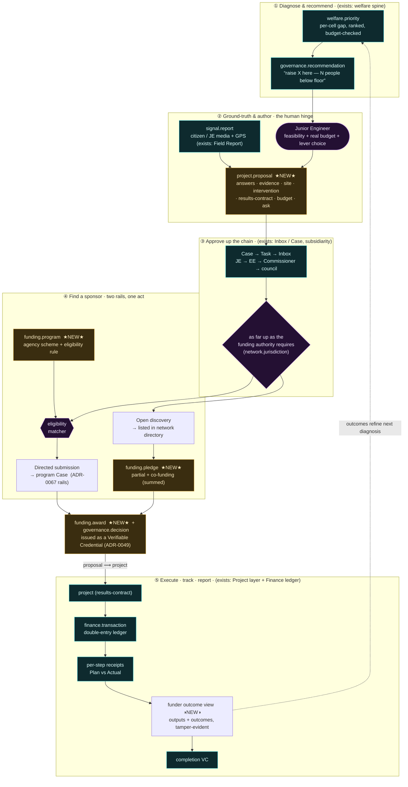

# ADR-0071 — From recommendation to funded project: the proposal → funding → delivery loop

- **Status:** Proposed (2026-09-04)
- **Deciders:** Airawat (platform steward), product owner
- **Composes / relates to:** ADR-0069 (welfare spine — the objective function; `welfare.priority` per-cell
  prioritisation is the *seed* of a proposal), ADR-0070 (uncertainty & publishability — the diagnosis a proposal
  is anchored to carries `prov` + a credible interval, so the ask is evidenced not asserted), ADR-0029 (decision
  spine — *AI recommends, a human authority decides*; the proposal is authored by a person, admitted by an
  authority), ADR-0046 (decision hourglass — facts+rules→decision→outcomes), ADR-0048 (Inbox & Case — the
  proposal travels the approval chain as a Case→Task→Inbox), ADR-0067 (civic **service federation** + hierarchical
  `network.jurisdiction` — the cross-agency rails and the subsidiarity ladder), the **Project layer** (results-contract
  lifecycle: propose→approve→execute→review→evaluate→adjust, Plan-vs-Actual on the real ledger), the **Finance core**
  (`finance.budget` / `finance.transaction`, double-entry ledger — where the money actually moves), the **Field
  Report** app (`signal.report` — citizen media + GPS, the ground evidence), ADR-0049 (Verifiable Credentials — the
  award and the completion certificate are VCs), ADR-0028 (civic personas + `governance.role_grant` — citizen,
  councillor, Junior Engineer, approving authority as governed roles), ADR-0041 (lineage — outputs trace to inputs),
  ADR-0038 (spec governance — the new nouns are proposed→approved→signed), ADR-0022 (everything-is-a-component —
  the matcher/authoring/report logic ships as certified engines/apps). External anchors: government scheme
  architecture (SBM, AMRUT, PMAY, Finance Commission grants), multilateral results-based financing, and
  accountable/participatory budgeting.

## Context

The welfare spine (ADR-0069) ends at a `governance.recommendation` — *"raise residential crowding in these
cells; ~19,539 people are confidently below the floor."* That is a **diagnosis**, not money and not action. In
the real world a diagnosis becomes change only when it is turned into a **fundable project** and a **funder** pays
for it. Today that journey is invisible to the platform: a recommendation has nowhere to go.

Observing how this actually happens in Indian urban governance:

- A gap is noticed — by a resident, a Resident Welfare Association, a ward councillor, a ward committee, or (now)
  by the system itself.
- Someone with authority to build — typically a **Junior Engineer (JE)** or a municipal officer — assesses
  feasibility on the ground, adds real evidence (photos, site visit, measurements), refines a **budget**, and
  writes it up as a **project proposal**.
- The proposal **travels up an approval chain** (JE → Executive Engineer → Commissioner → council / competent
  authority) as far as the funding authority requires.
- It is **funded** by one of several routes: the agency's own budget / revenue / untied grants; **submission to a
  program** run by a central ministry, a state department, a Finance Commission, or a multilateral; or — for
  smaller, discrete works (a school library, a sanitation block, pothole repair, a sports event) — **open
  discovery**, where any interested party (CSR, philanthropy, diaspora, a peer city, a citizen) can fund all or
  **part** of it.
- Once funded it becomes a **project** that must be **tracked** so that funders get reliable data on **outputs and
  outcomes**, not a self-reported PDF.

Almost every capability this requires **already exists** in the platform as a governed component — the
recommendation (welfare spine), the ground evidence (Field Report / `signal.report`), the human decision gates
(decision spine + Inbox/Case), the execution+tracking (Project layer), the money (Finance ledger), the
cross-agency rails (service federation + network directory), the completion proof (VCs), the actors (civic
personas). What is missing is the **connective tissue**: the artifact that carries a diagnosis across the chasm
from "noticed" to "funded and delivered," and the funding vehicles it plugs into.

## Decision

Introduce a small set of governed nouns and reuse the existing spine to make the **recommendation → proposal →
funding → project → outcome** loop first-class. The decision has five parts.

### 1. `project.proposal` — the pivot artifact (pre-money)

A governed noun that **binds** what already exists into a bankable case. A proposal carries:

- `answers` — the `governance.recommendation` / `welfare.priority` ids it responds to (the *why*, with provenance
  and a credible interval from ADR-0070);
- `evidence` — `signal.report` ids (citizen/JE media + GPS) and any documents;
- `site` — the cells / ward / `network.jurisdiction` it acts on;
- `intervention` — the chosen lever(s) from the intervention catalog (see ADR-0069 Step 2), each with a cost and
  an environmental draw;
- `results_contract` — outputs, outcomes, and indicators (the Project layer's existing shape, declared *before*
  money);
- `budget` — real line items → maps to `finance.budget`;
- `ask` — amount requested, and whether it is **addressed** (to a named program) or **open** (posted for discovery);
- `author` / `sponsor` / `beneficiary` — the JE who wrote it, the agency proposing, the population served.

The proposal is authored by a **person** (the JE feasibility step *is* the decision-spine human gate: AI narrows
the search, a human on the ground makes it fundable and resolves what the model could not — e.g. whether land is
actually available). It has its own lifecycle: **draft → submitted → under-review → (revise) → awarded | rejected
| lapsed**. It can be partially funded and resubmitted.

### 2. `funding.program` — the funding vehicle (first-class, discoverable)

An agency's scheme, listed in the network directory: a theme, an **eligibility rule**, a budget envelope, an
application window, and **reporting requirements**. Making the program a governed noun (not an out-of-band PDF)
means a proposal can be **auto-matched** to the programs it qualifies for: a sanitation gap in a slum cell matches
SBM; a road-safety gap matches a state PWD line; a crowding gap matches an urban-renewal window. The funder's
criteria find the proposal, rather than the proposer hunting for a funder.

### 3. `funding.pledge` / `funding.award` — the commitment (partial-capable)

A `funding.pledge` is a commitment of money to a proposal by a funder; **multiple pledges may co-fund** one
proposal (they sum toward the ask), so open discovery is *accountable crowdfunding* rather than all-or-nothing. A
`funding.award` is the binding grant that flips a proposal into a project; it is minted together with a
`governance.decision` and issued as a **Verifiable Credential** (ADR-0049) the funder and the recipient both hold.

### 4. Two funding rails, one act

Submitting to a ministry and posting to the directory are the **same act** — *a proposal seeking a sponsor* —
differing only in whether the sponsor is **pre-addressed** or **discovered**:

- **Directed submission** → a specific `funding.program`. Reuses the ADR-0067 service-federation rails
  (init → provider Case → confirm/status → receipt): submitting a proposal opens a Case with that program's
  operator, who reviews and awards.
- **Open discovery** → the proposal is listed in the network directory; any participant discovers it and pledges
  all or part. Co-funding via summed `funding.pledge`s.

Both converge on the same `funding.award` → project transition.

### 5. Subsidiarity via jurisdiction; accountability via the rails

- **Subsidiarity.** A proposal travels **up the `network.jurisdiction` hierarchy only as far as the funding
  authority requires** — a pothole is ward-funded from own revenue; a trunk sewer needs state/central. "How far
  up" is a lookup against the governed hierarchy (ADR-0067), not a guess. Fund at the lowest capable level.
- **Accountability is structural — this is the actual product.** A funder's real question is *"where did the money
  go and did it work?"* Here the answer is tamper-evident by construction: the ask is anchored to a governed
  diagnosis (with provenance + uncertainty), the money moves through the **double-entry finance ledger**,
  execution is a **results-contract with per-step receipts** (Plan-vs-Actual on real data), and completion is a
  **VC**. The funder receives reliable output+outcome data, not a report. This is precisely what lets a small or
  remote project — a school library, a ward sanitation block, a sports meet — attract money it never could
  before: the trust lives in the rails, not in personally knowing the JE.

### Keep proposal and project distinct

Do **not** collapse proposal and project into one object. The **proposal** is pre-money (a case seeking a sponsor;
rejectable, partially-fundable, resubmittable). The **project** is post-award (a funded results-contract being
executed and tracked). The **award is the state transition** between them, and the point at which a
`governance.decision` and a `funding.award` VC are minted together.

## The lifecycle

## What is new vs reused

**Reused as-is (~80%):** welfare spine (diagnosis), Field Report / `signal.report` (evidence), decision spine +
Inbox/Case (approval routing + gates), Project layer (execution + Plan-vs-Actual tracking), Finance ledger
(money), service federation + network directory + jurisdiction (rails + subsidiarity), VCs (award + completion),
civic personas (actors).

**New (the small surface):**
1. `project.proposal` — the pivot noun (binds recommendation + evidence + feasibility + budget + results-contract + ask).
2. `funding.program` — the agency scheme (eligibility rule → auto-matching).
3. `funding.pledge` / `funding.award` — the commitment (pledge is partial-capable → co-funding).
4. a **proposal→program eligibility matcher** engine.
5. a **JE authoring surface** ("Proposal Studio," or extend the Project Console) — recommendation + field reports draft into a proposal.
6. a **funder outcome view** over project receipts — the report that closes the loop back to the diagnosis.

## Consequences

- **Positive.** The objective function stops at a recommendation no longer; it now has a governed path to money and
  delivery. Small/remote works become fundable because accountability is structural. Funders — from a ward's own
  untied grant to a multilateral — transact against evidenced, tracked, tamper-evident projects. Open discovery
  turns the directory into an accountable marketplace of civic projects. Outcomes feed back to sharpen the next
  diagnosis (a closed loop).
- **Costs / risks.** New nouns must clear spec governance (ADR-0038) and be house-rule-clean. The eligibility
  matcher is only as good as the machine-readability of program rules — real schemes have messy, discretionary
  criteria; the matcher must *surface candidates for a human*, never auto-award. Open-discovery funding raises
  fiduciary, KYC/AML, and misuse questions that live outside this ADR and must be gated before real money flows.
  The JE authoring step is a real human workload; the value is that the AI pre-fills 80% (site, people, indicative
  budget, lever menu), leaving feasibility judgement to the person.
- **Explicitly out of scope here.** Payment execution / escrow / disbursement mechanics; procurement and tendering;
  KYC/AML and funder onboarding; the intervention catalog itself (ADR-0069 Step 2, which feeds the proposal's
  `intervention` field). This ADR defines the *lifecycle and the artifacts*, not the payment rails.

## Slice plan (proposed)

1. **S1 — the pivot.** Govern `project.proposal`; a "draft proposal from recommendation" action that pre-fills
   from `welfare.priority` + attaches `signal.report`s; route as a Case up the jurisdiction chain to a
   `governance.decision`. (Proves recommendation → authored, approvable proposal.)
2. **S2 — self-funded delivery.** Award from the agency's **own** `finance.budget` → project → track Plan-vs-Actual
   → completion VC. (Proves the full loop without external funders.)
3. **S3 — programs + matcher.** Govern `funding.program`; eligibility matcher surfaces candidate programs; directed
   submission via the ADR-0067 Case rails.
4. **S4 — open discovery + co-funding.** List proposals in the directory; `funding.pledge` (partial, summed);
   `funding.award` VC; the funder outcome view.
