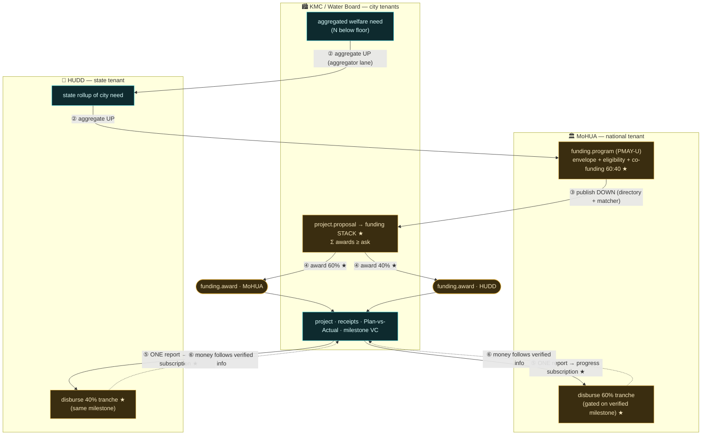

# ADR-0072 — Federated program funding: the information-gates-money loop across tenants

- **Status:** Proposed (2026-09-04)
- **Deciders:** Airawat (platform steward), product owner
- **Composes / relates to:** ADR-0071 (recommendation → proposal → funded project; this ADR is its S3/S4 —
  external, multi-tenant funding), ADR-0067 (civic **service federation** + hierarchical `network.jurisdiction`
  — nation → state → city → ward, the topology money and data move along), the **cross-tenant aggregator lane**
  (`/v1/data-requests` file → approve → issued grant + kernel cross-tenant gate — the data-sharing seam this ADR
  leans on in both directions), ADR-0049 (Verifiable Credentials — awards and milestone completions are VCs the
  funders hold), the **Project layer** (results-contract + per-step receipts + Plan-vs-Actual), the **Finance
  core** (`finance.budget` / `finance.transaction`, double-entry — where disbursements post), ADR-0029 (decision
  spine — a disbursement is a *decided* change-request, never automatic), ADR-0056 (decided change-request),
  ADR-0052 (attributed writes — every cross-tenant fact carries who asserted it). External anchors: India's
  centrally-sponsored scheme architecture (PMAY-U, AMRUT, Jal Jeevan Mission, Finance Commission grants), the
  **60:40 Centre:State** funding pattern, PFMS/just-in-time release, and multilateral results-based financing.

## Context

The welfare loop (ADR-0069/0071) ends, today, at a proposal a city can approve and self-fund. But most civic
capital does not work that way. A city rarely has the money; it comes **down** from programs a central ministry
runs, usually **co-funded** with the state (the classic **60:40 Centre:State**), sometimes with a multilateral
or a bank tranche. The city applies, the money is released in **instalments gated on reported progress**, and the
same execution has to be reported to **every** funder — the ministry, the state, the bank — each on its own
portal, in its own format.

This is **fiscal federalism as a data problem**. The binding cost is not the money; it is the **coordination**:
dozens of autonomous agencies (municipalities, water boards, state departments, ministries) reconciling PDFs and
portal entries, funds stuck because a utilisation certificate is late, need assessed from a stale census. Every
actor is sovereign over its own data, so nobody has one true picture.

The observation that organises the whole design: **the flow of information across agencies determines the flow of
money.** A tranche cannot be released until a verified progress report reaches the funder. If we make that
information flow governed, shared, and tamper-evident, the money flow follows it automatically — and the
coordination cost, which is what actually stalls these schemes, collapses.

## Decision

Model the participants as a **federation of tenants on the jurisdiction ladder**, and move need, programs,
proposals, money, and monitoring along it as governed cross-tenant flows. Six parts.

### 1. Tenants are the jurisdiction hierarchy

Each actor is its own tenant with its own data sovereignty, placed on the existing `network.jurisdiction` ladder
(ADR-0067): a **ministry** (e.g. MoHUA) at national level; a **state department** (e.g. HUDD, UP) at state level;
**cities** (KMC) and **city utilities** (Kanpur Jal Sansthan / a water board) at city level; **multilaterals /
banks** as external funder participants. "Who funds what" and "who reports to whom" are lookups against this
ladder, not bespoke config.

### 2. Need flows UP (aggregation) — cities → state → ministry

Cities push **aggregated** welfare need up the ladder — e.g. "N people below the crowding floor", "M below the
water floor" — the state rolls up across its cities, and pushes the state total to the ministry. Raw per-cell
data stays in the city (privacy + scale); only aggregates cross the boundary, via the **cross-tenant aggregator
lane**. The ministry designs programs and sizes envelopes against **current, real** need. This is where
interoperability yields the most: allocation informed by live ground truth, not a stale survey.

### 3. Programs flow DOWN (discovery) — with a co-funding structure

A ministry publishes a `funding.program` (ADR-0071) to the directory, extended with a **funding structure**: the
set of co-funders and their shares — `[{funder: MoHUA, share: 0.6}, {funder: HUDD, share: 0.4}]`, optionally a
multilateral/bank tranche and a ULB/beneficiary contribution. Eligibility + envelope + **reporting requirements**
travel with it. Eligible agencies discover it through the ADR-0071 matcher.

### 4. Proposals flow UP → a FUNDING STACK (multi-award)

An agency's proposal (ADR-0071) is submitted to a program — but its ask is rarely met from one source. It is a
**braid**: 60:40 within one program, or several programs stacked (PMAY-U housing + AMRUT trunk-infra + ULB
own-share + beneficiary contribution). So a proposal accumulates **multiple `funding.award`s**, each carrying its
funder, program, and share, and is fully funded when **`Σ awards ≥ ask`**. Each award is a separate signed
commitment from its own tenant — a partial pledge that composes, exactly as ADR-0071's `funding.pledge` foresaw,
now across jurisdictions.

### 5. Monitoring flows UP — one project, many funder audiences

The executing agency reports **once**: the project's receipts, Plan-vs-Actual, and milestone VCs (the Project
layer already produces these). That single tamper-evident record is shared to **every** co-funder through a
governed read-grant — the aggregator lane in reverse: each funder holds a **progress subscription** on the
project it co-funds. No parallel reporting, no reconciliation; one governed truth, N subscribers, each seeing the
same numbers.

### 6. Money is gated on information (tranched disbursement)

Disbursement is **tranched and contingent**: a funder's next release is a **decided change-request** (ADR-0029/56)
whose precondition is a **verified milestone receipt/VC** arriving over its progress subscription. Money cannot
move until the information moves. Each co-funder releases its share of the tranche against the same verified
milestone, in its ledger, with a VC receipt. This is the literal implementation of *information flow determines
money flow*.

## The flows

## What is new vs reused

**Reused:** `network.jurisdiction` + service federation (ADR-0067); the **cross-tenant aggregator lane** (both
directions — need up, progress down to funders); ADR-0071 (`project.proposal`, `funding.program`,
`funding.pledge`/`funding.award`, the matcher); the Project layer's receipts + Plan-vs-Actual; the Finance ledger;
VCs; the decision spine.

**New for this ADR:**
1. `funding.program` **co-funding structure** (co-funders + shares + external tranches).
2. **Funding stack / multi-award** on a proposal (`Σ awards ≥ ask` across programs and funders).
3. **Cross-tenant progress subscription** — a funder's governed read-grant on a co-funded project's receipts.
4. **Tranche-release gate** — a disbursement decided change-request whose precondition is a verified milestone.
5. **Hierarchical need aggregation** — city → state → ministry rollups over the aggregator lane.

## Consequences

- **Positive.** Coordination cost — the real bottleneck — collapses: one governed project, one report, many
  funders, all seeing the same tamper-evident truth; tranches release on verified progress instead of on portal
  reconciliation. Ministries allocate against live need. Co-funding (60:40, multilateral tranches, ULB share) is
  first-class, not spreadsheet glue. The federation's value is finally legible: **the gains are largest exactly
  where data crosses tenant boundaries.**
- **Costs / risks.** Cross-tenant sharing must be consented and least-privilege (aggregates up, project-scoped
  receipts to funders — never raw citizen data). Disbursement gating touches real money: the tranche decision
  stays a **human-admitted** decision (ADR-0029), the platform only supplies the verified precondition; it never
  moves money autonomously. Fund flow integration with PFMS/treasury is an external boundary, out of scope here —
  this ADR models the *decision and the evidence*, not the payment rail. Aggregation math must be honest (ADR-0070
  intervals survive the rollup). Trust rests on the CA + steward-key hygiene across many tenants (cf. the KMC
  steward-key reconciliation) — more tenants, more key surface.
- **Out of scope here.** The payment/treasury rail (PFMS, RBI e-Kuber); procurement/tendering; KYC/AML and funder
  onboarding; the beneficiary-contribution collection mechanics. Modeled: the tenant topology, the five flows, the
  funding stack, and the information-gates-money release rule.

## Slice plan (proposed)

1. **S3a — topology.** Provision MoHUA (national) + HUDD (state) + a water-board city-utility tenant on the
   jurisdiction ladder; wire the city→state→ministry need aggregation over the aggregator lane.
2. **S3b — co-funded program + funding stack.** `funding.program` with a co-funding structure; a proposal
   accumulates 60:40 awards from MoHUA + HUDD until `Σ awards ≥ ask`.
3. **S3c — progress subscription.** A co-funder gets a governed read-grant on the project's receipts; one report
   reaches all funders.
4. **S3d — tranche gate.** A disbursement decided change-request gated on a verified milestone VC; each funder
   releases its share in its own ledger.
