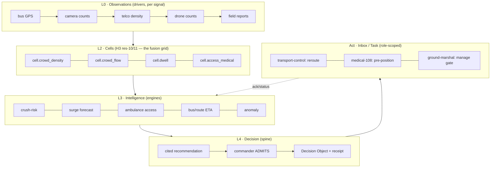
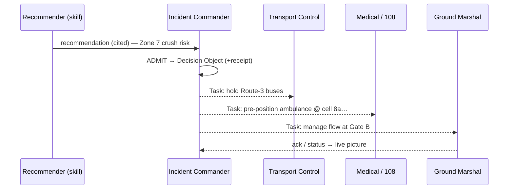

# Crowd-Safety for Mass Gatherings — Solution Architecture (Kumbh / Nashik)

**Status:** Sketch / design intent · **Scope:** a governed AirawatOS *Solution* for real-time safety &
comfort management of a large religious gathering (buses, crowd, medical, sanitation).
**Reuses:** ADR-0053 (data-model layers), ADR-0029/0046 (decision spine/hourglass), ADR-0048
(Inbox/Case/Task), ADR-0062 (invocation + triggers), roles-as-governed-vocabulary, federation
(data-at-source), City Scan L0–L4 ladder.

---

## 1. Design stance

A crowd-safety command capability is **not a bespoke app** — it is a Solution composed of governed
components on the same `sense → cells → intelligence → decision → act` loop as every other AirawatOS
vertical. Four commitments shape every choice below:

1. **One fusion substrate.** Heterogeneous sensors (bus GPS, cameras, telco, drones, field staff) are
   incomparable as raw feeds. They become comparable only when each lands on a **common H3 cell grid**.
   Fuse on cells, reason on cells.
2. **Human-in-the-loop by construction.** AI produces *cited recommendations*; a human **incident
   commander admits** them into a **Decision Object**; nothing acts autonomously. For a life-safety,
   multi-agency operation this is non-negotiable — and it is already how the spine works (ADR-0029/0046).
3. **Privacy-by-design.** Crowd + telco + camera data is surveillance-adjacent. Aggregate **at source**,
   count **don't identify**, purpose-bind, retain briefly, attribute everything. Governance is the feature.
4. **Real-time is the one true build.** Everything else maps onto what exists; the clock does not. A
   gathering needs **seconds-to-minutes**, not hourly ticks. This forces the event-driven path (ADR-0062).

---

## 2. Layered model (ADR-0053 · City Scan L0–L4)



---

## 3. Sensing layer — signal → driver → schema

Each source is an **ingest driver** writing a governed schema. Streaming sources push; batch sources tick.

| Signal | Driver (kind=driver) | Writes (L0/L1) | Notes |
|---|---|---|---|
| Bus / shuttle GPS | `mobility-avl` | `mobility.vehicle_position` | live AVL; from transport dept (federated) |
| Fixed cameras (people counting) | `crowd-camera` | `crowd.count_observation` | **counts per zone only** — no identity |
| Drone counts / imagery | `crowd-drone` | `crowd.count_observation` | on-demand; tasked to hotspots |
| Mobile-operator density | `telco-density` (connector) | `crowd.density_report` | **aggregated at source** — per-cell counts, never tracks |
| On-ground personnel (mobile) | Field Report app | `signal.report` | media + GPS + category (your existing pattern) |
| Weather / heat | `weather-forecast`, `heat` | `cell.weather_forecast`, `cell.heat` | comfort + heat-stress context (already built) |
| Facilities (toilets, water, medical posts, gates) | `osm-facilities` (+ manual) | `geo.facility` | static; already ingested |

---

## 4. Cell measures (L2 — the fusion grid)

Resolution is **finer than a city** — H3 **res-10 (~65 m) to res-11 (~25 m)** — because crowd risk is a
small-area phenomenon. Every sensing driver reduces onto these:

| Schema | Meaning | Fused from |
|---|---|---|
| `cell.crowd_density` | people / m² per cell, per timestamp | cameras + telco + drone |
| `cell.crowd_flow` | flow vector (direction + rate) | successive density frames; AVL near routes |
| `cell.dwell` | mean dwell time | density persistence |
| `cell.access_medical` | reachability of nearest medical unit (min) | facilities + flow (congestion-aware) |
| `cell.comfort` | heat/shade/water/toilet adequacy index | heat + facilities + density |

These are temporal (per `observed_at`) — and the **generic City Scan scrubber** we just built animates
them out of the box.

---

## 5. Intelligence engines (L3)

| Engine | Reads | Writes | Purpose |
|---|---|---|---|
| `crush-risk` | `cell.crowd_density` | `safety.crush_risk` | density > threshold bands (e.g. >5/m² caution, >6 danger) |
| `surge-forecast` | `cell.crowd_flow` | `safety.surge_forecast` | where a bottleneck forms in N minutes |
| `medical-access` | facilities + flow | `cell.access_medical` | nearest **reachable** ambulance given congestion |
| `route-advisor` | AVL + flow | `mobility.route_advisory` | bus holding / rerouting / ETA |
| `anomaly-watch` | density deltas | `signal.alert` | sudden spike / stampede precursor |

Engines are pure functions over cells — same pattern as station-interpolation / hotspot-detection.

---

## 6. Decision spine (L4 — the crux)

This is what separates a **command system** from a dashboard, and it is already the platform's backbone
(ADR-0029 decision spine, ADR-0046 hourglass):

```
facts (cells + alerts) + rules (thresholds, SOPs)
        → governance.recommendation   (AI, CITED to the evidence + rule)
        → authority ADMITS            (incident commander — a governed role)
        → governance.decision         (the neck of the hourglass; evidence manifest + receipt)
        → outcomes                    (tasks dispatched)
```

- **The AI never dispatches.** It recommends: *"Zone 7 at 6.1/m², inflow rising 8%/min → divert at Gate B,
  hold Route-3 buses, pre-position 108 at cell 8a…"* — each clause **cited** to the density fact + the SOP
  rule that fired.
- **Every decision is a receipt.** Who admitted it, on what evidence, when — an auditable
  `interaction.receipt` + `prov.*` trail. For a government safety operation reviewed after the fact, this
  is the single most important property.
- **Recommendation types** (governed): `divert-inflow`, `open/close-gate`, `hold/reroute-transport`,
  `pre-position-medical`, `deploy-marshals`, `broadcast-advisory`.

---

## 7. Action & coordination (Inbox / Case / Task)

A Decision fans out as **role-scoped Tasks** into each actor's **Inbox** (ADR-0048). One incident =
one **Case**; the workflow tracks it to closure.



Closed loop: task ack + status feed back into the operating picture, and `medical-access` re-computes as
units move.

---

## 8. Roles & multi-agency federation

Each actor is a **governed role** (network.role grammar) with scoped RBAC; each agency is a **participant**
consumed **at source** (federation — you never copy their operational systems):

| Actor | Role | Agency (participant) | Consumes / produces |
|---|---|---|---|
| Incident commander | `safety.incident-commander` | Disaster mgmt / district | admits decisions |
| Police control | `safety.police-controller` | Police | gate/flow orders |
| Medical dispatch | `health.medical-responder` | 108 / health | ambulance status + pre-position |
| Transport control | `mobility.transport-controller` | Transport / bus dept | AVL feed + reroute |
| Ground marshal | `safety.ground-marshal` | On-ground volunteers | field reports + task ack |
| Sanitation | `urban.sanitation-officer` | Municipal | toilet/water status |

**Data-at-source:** bus AVL stays in the transport system and is resolved via a connector; telco density
is aggregated inside the operator boundary and only aggregates cross into the tenant. No central honeypot.

---

## 9. Governance & privacy (must-address)

| Concern | Design rule |
|---|---|
| Individual tracking | **Prohibited.** Telco → per-cell counts only; cameras → counts, **no face-rec** unless separately lawful + governed. |
| Purpose-binding | Facts carry purpose = crowd-safety; retention short (hours–days), enforced. |
| Provenance | Every fact + decision attributed (`prov.*`), every AI/egress step a `interaction.receipt`. |
| Access | Role-scoped; a marshal sees their sector, the commander the whole picture; grants signed. |
| Accountability | Decision Objects are the permanent, reviewable record of every intervention. |

The governance layer you've built is not overhead here — it is the thing that makes the capability
defensible to a court, a commission, or the public.

---

## 10. The real-time gap (the one genuine build)

Today the platform is **batch/scheduled** (hourly ticks — hardened this session). Crowd safety needs a
**streaming path**:

- **Ingestion:** push (webhook/stream) for AVL + camera counts, not cron pulls.
- **Aggregation:** incremental cell updates on each event, not full re-scans.
- **Alerting:** `platform.event` on a threshold crossing → trigger the recommender immediately (ADR-0062
  triggers — an engine subscribes to upstream writes and fires on change).
- **Latency budget:** density → risk → recommendation in **< 60 s**; commander → task in operator time.

This is the spine upgrade this vertical forces. Everything else is composition.

---

## 11. The operations app (command center)

A live app (City Scan lineage, real-time): crowd **heatmap** + flow arrows, **bus & ambulance positions**,
**alert rail**, and a **decision panel** (recommendation → admit → dispatch board with task status). Big-
screen for the control room; role-scoped mobile views for marshals/medical.

---

## 12. Component inventory (build vs reuse)

- **Reuse:** H3 cell model, City Scan + generic temporal scrubber, Field Report → `signal.report`,
  facilities/heat/weather layers, decision spine, Inbox/Case/Task, roles + RBAC, federation, receipts.
- **Build (drivers):** `mobility-avl`, `crowd-camera`, `crowd-drone`, `telco-density` (connector).
- **Build (engines):** `crush-risk`, `surge-forecast`, `medical-access`, `route-advisor`, `anomaly-watch`.
- **Build (skill/expert):** `crowd-safety-advisor` (facts × SOP rules → cited recommendation).
- **Build (app):** command-center operations app.
- **Build (platform):** the **real-time trigger/streaming path** (§10) — the critical dependency.
- **Bundle:** a `mass-gathering-safety` **Solution** pinning the above (one install per event/city).

---

## 13. Phased delivery

1. **Live operating picture** — buses on a real-time map (you already ingest transit) + manual incident
   feed. Proves the command-center app **and the real-time path** on the cheapest signal.
2. **Crowd density layer** — one source (cameras *or* telco aggregates) → `cell.crowd_density` heatmap +
   threshold alerts. Proves fusion + alerting.
3. **The decision loop** — recommendation → commander admits → **one** task type (divert inflow). Proves
   human-in-the-loop + receipts. *Highest value; do this before breadth.*
4. **Multi-agency + more signals** — drones, telco, 108 dispatch as federated participants; fuse; scale.

---

## 14. Open questions

- Camera counting: on-device (edge) vs. central inference? (privacy + bandwidth favor edge counts.)
- Telco aggregation contract: cell size, refresh rate, legal basis with the operator.
- SOP encoding: whose thresholds/rules govern (NDMA? district? event-specific)? — these become
  `governance.rule` records the recommender cites.
- Offline/degraded operation at the ground (connectivity is unreliable at scale).
- Nashik AOI + baseline substrate already exists as a tenant — this vertical sits on top of it.

---

*This is a sketch to align on shape, not a committed build. The critical-path dependency is the real-time
trigger/streaming spine (§10); the rest is composition on the existing platform.*
